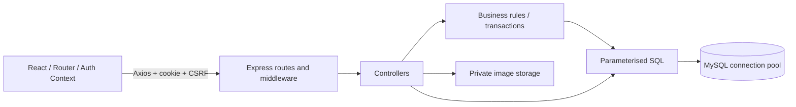
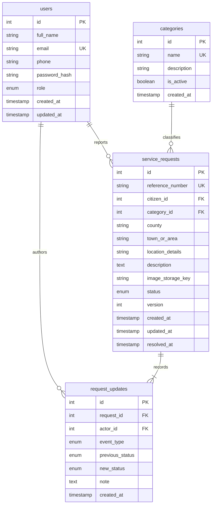

# Mwananchi

A public service request system built for assessment and learning. Citizens report local issues and follow their progress; administrators publish updates and record resolutions. **This is a demonstration project, not an official government platform.** It does not forward reports to government agencies and uses no government logos.

## Stack and requirements

- Node.js **22.13+ in the 22 LTS line, or 24 LTS** (recommended), npm 10+.
- MySQL **8.0.16+**, preferably MySQL 8.4 LTS. Use MySQL, not SQLite or MariaDB.
- React 19, Vite, React Router, Axios, Context, Bootstrap 5, Lucide icons, Recharts.
- Express 5, mysql2/promise, bcrypt, JWT cookies, Zod, Multer, sharp, Helmet, rate limiting.
- ESLint, Prettier, Vitest, React Testing Library, Supertest.

Vite's minimum runtime is documented in its [official guide](https://vite.dev/guide/); Express 5's runtime and migration details are in the [official Express documentation](https://expressjs.com/en/guide/migrating-5/). The root `package-lock.json` locks both npm workspaces. Install from the repository root.

## Quick start

For the project-local Windows database, see [Local MySQL setup](docs/LOCAL_MYSQL.md). Once configured, use `npm run mysql:start` before starting the application. The manual database setup below also works with a separately installed MySQL server.

### 1. Create the development database

Install and start MySQL, then open the MySQL shell as an administrative user:

```sql
CREATE DATABASE hudumatrack CHARACTER SET utf8mb4 COLLATE utf8mb4_0900_ai_ci;
CREATE USER 'huduma'@'localhost' IDENTIFIED BY 'choose-a-local-password';
GRANT SELECT, INSERT, UPDATE, DELETE, CREATE, ALTER, INDEX, REFERENCES
  ON hudumatrack.* TO 'huduma'@'localhost';
```

Use `DB_HOST=localhost` if your server's account resolution requires it. The application never creates a database automatically. For production, use a migration account with schema privileges and a runtime account with only SELECT, INSERT, UPDATE and DELETE.

### 2. Install and configure

Run in this directory (the directory containing `client`, `server`, and the root `package.json`):

```powershell
npm ci
Copy-Item server/.env.example server/.env
Copy-Item client/.env.example client/.env
```

On macOS/Linux replace `Copy-Item` with `cp`. Edit `server/.env`: set the database password, a random JWT secret of at least 32 characters, and the initial administrator credentials. Generate a secret with:

```sh
node -e "console.log(require('node:crypto').randomBytes(48).toString('hex'))"
```

The administrator seed password must be at least 12 characters. Use an email you choose; there is no built-in login or hard-coded production password. Environment files are ignored by Git.

### 3. Migrate and seed

```sh
npm run migrate
npm run seed
```

Migrations run in filename order and record completed files in `schema_migrations`. A MySQL advisory lock prevents simultaneous migration runners. The essential seed creates six service categories and the initial administrator. Running it again does not duplicate records or reset an existing administrator's password. It refuses to promote an existing citizen with the same email. There are no sample citizens or fabricated requests.

MySQL schema changes implicitly commit: migrations are not automatically rolled back. Back up an existing database before future schema changes. If an initial migration is interrupted, inspect the partially created schema before retrying; never delete a populated database to fix a migration error.

### 4. Start development

```sh
npm run dev
```

Open [Mwananchi](http://localhost:5174). Vite proxies `/api` to Express on port 4000. Keep using the same hostname (`localhost`, not a mixture of localhost and 127.0.0.1), so cookies and origin checks agree. Register a citizen or sign in with your seed administrator credentials.

The pre-existing `mwananchi/` starter has been preserved and is not used by Mwananchi. Run all commands from the workspace root, not that starter directory.

## Configuration

| Variable                                                     | Purpose / default                                                    |
| ------------------------------------------------------------ | -------------------------------------------------------------------- |
| `NODE_ENV`                                                   | `development`, `test`, or `production`                               |
| `PORT`                                                       | Express port, 4000                                                   |
| `DB_HOST`, `DB_PORT`                                         | MySQL host and port (127.0.0.1, 3306)                                |
| `DB_NAME`, `DB_USER`, `DB_PASSWORD`                          | Database and restricted user credentials                             |
| `JWT_SECRET`                                                 | Required secret, minimum 32 characters                               |
| `JWT_EXPIRY`                                                 | JWT duration, `8h`; cookie lasts for the browser session             |
| `FRONTEND_ORIGIN`                                            | Exact permitted browser origin, `http://localhost:5174`              |
| `UPLOAD_DIR`                                                 | Image directory, resolved relative to `server/`; default `./uploads` |
| `MAX_UPLOAD_SIZE`                                            | Bytes; default and maximum 5,242,880 (5 MiB)                         |
| `VITE_API_BASE_URL`                                          | Client API prefix, `/api`                                            |
| `SEED_ADMIN_NAME`, `SEED_ADMIN_EMAIL`, `SEED_ADMIN_PASSWORD` | Essential seed inputs                                                |

Use a same-origin deployment. In production, Express serves the built React app and `/api`. Set `FRONTEND_ORIGIN` to the exact HTTPS public origin, set `NODE_ENV=production`, build, then start:

```sh
npm run build
npm start
```

Terminate TLS with a reverse proxy. HTTPS is required for production's Secure cookies. Forward requests to Express without exposing it directly; configure proxy/IP handling to match your deployment before relying on per-client rate limiting behind a proxy. Do not blindly enable `trust proxy` on an exposed server. Persist and back up both MySQL and the upload directory. Google Fonts are optional; local sans-serif fallbacks work offline.

## Architecture

See the [frontend code guide](docs/FRONTEND.md) for the screen/component structure and a walkthrough of how routes, pages, components and hooks work together.

See [profile and password management](docs/ACCOUNT.md) for account editing, password validation, session protection and the responsive layout changes.

```text
client/src/
  components/        Shared forms, filters, table, timeline and state components
  context/           Session restoration and authentication state
  hooks/             Cancellable API data loading
  layouts/           Shared sidebar and header
  pages/             Landing, auth, citizen and admin views
  services/          Axios instance and CSRF headers
  styles/            Responsive Bootstrap customisations
  utils/             Status labels and EAT date formatting
server/
  src/config/        Environment and MySQL pool
  src/routes/        URLs, role checks and upload middleware
  src/controllers/   HTTP input parsing and response formatting
  src/services/      Creation and status business rules, transactions
  src/repositories/  Parameterised database queries
  src/middleware/    Authentication, CSRF, uploads and error responses
  src/validators/    Zod schemas
  src/utils/         Errors, JSON and CSV helpers
  database/migrations/ Versioned schema
  database/seeds/    Repeatable categories and initial admin
  tests/            Rule tests and separate-MySQL integration tests
docs/               API reference and assessment walkthrough
```



Routes enforce permissions before controllers run. Controllers translate HTTP inputs; services enforce rules; repositories contain SQL. Auth operations use a small user repository. This avoids unnecessary frameworks or generic data-access abstractions.



UTC is set on every MySQL connection; timestamps are returned as ISO dates and formatted in Africa/Nairobi (EAT) in the UI. Date filters refer to UTC calendar dates. Indexes cover citizen, category, status and submission date.

## Features and security decisions

- Citizens register and log in, view their profile, report issues and track only their own requests. Registration strips role and other unexpected fields, normalises email, checks password confirmation and relies on a unique database constraint to handle duplicate-email races.
- Citizens and admins can edit their own name and optional phone in the redesigned profile. Email and role remain read-only. Password changes require the current password, a different new password and matching confirmation. The API invalidates other sessions while preserving the current one.
- JWTs are signed with HS256, a fixed issuer and audience. Cookies are HttpOnly, SameSite=Lax, and Secure in production. No tokens are stored in localStorage. `/auth/me` restores the session; expired sessions return users to login.
- A random CSRF cookie and matching response token must accompany every write through `X-CSRF-Token`, including login. JavaScript obtains the token from `/auth/csrf`; CORS permits only the configured origin, and writes check Origin when supplied. The CSRF cookie itself is HttpOnly. Refreshing obtains a new token if needed.
- All data queries parameterise user values. Sort direction and SQL column names come from fixed code. Backend permissions apply even if someone bypasses React navigation.
- Citizen lists always use the authenticated ID, and details/images hide other citizens' records with 404 responses. Administrators see reporting contact details.
- Request IDs, reference numbers, ownership and initial status are generated on the server. Creation and the first timeline event share a transaction.
- Status updates lock the database row, compare the submitted `version`, permit only Pending → In Progress → Resolved, and record the actor, note, old/new status and timestamps together. Resolution requires a note. Stale submissions return 409; comments also increment the version.
- The admin summary aggregates all MySQL records, independently of table pagination. Open means Pending + In Progress. Citizen summaries are scoped to their own records.
- Uploads accept one JPEG, PNG or WebP, at most 5 MiB. Extension, claimed MIME and file signatures must agree. Sharp decodes with a 40-million-pixel limit and re-encodes to WebP, stripping metadata. Files get random UUID names and live outside static assets. Failed creation deletes the newly stored file. Images pass through an authenticated ownership check; filenames cannot traverse directories.
- Descriptions and notes render as React text. Error responses hide SQL and stack traces. Logs include an error type/code only. Credentials and tokens are never logged.
- Auth writes are limited to 30 attempts per 15 minutes per IP. Helmet adds security headers. CSV export includes every filtered page and quotes fields while neutralising formula prefixes, including whitespace before `=`, `+`, `-` or `@`.
- Printing request details produces a citizen summary with its reference, status, location, timestamps, image and timeline.

## API

See [complete API documentation](docs/API.md) for inputs, filtering, responses and examples.

| Method | Endpoint                                                        | Access                                              |
| ------ | --------------------------------------------------------------- | --------------------------------------------------- |
| GET    | `/api/auth/csrf`                                                | Public                                              |
| POST   | `/api/auth/register`, `/api/auth/login`, `/api/auth/logout`     | Public + CSRF                                       |
| GET    | `/api/auth/me`                                                  | Signed in                                           |
| GET    | `/api/categories`                                               | Signed in                                           |
| POST   | `/api/requests`                                                 | Signed in; creates an owned request                 |
| GET    | `/api/requests`, `/api/requests/:id`, `/api/requests/:id/image` | Owner or admin for details/image; list always owned |
| GET    | `/api/dashboard/citizen`                                        | Signed in, own totals                               |
| GET    | `/api/admin/requests`, `/api/admin/requests/:id`                | Admin                                               |
| PATCH  | `/api/admin/requests/:id/status`                                | Admin + CSRF                                        |
| POST   | `/api/admin/requests/:id/updates`                               | Admin + CSRF                                        |
| GET    | `/api/admin/analytics`, `/api/admin/requests/export`            | Admin                                               |

## Tests and checks

```sh
npm run lint
npm test
npm run build
```

`npm test` runs backend rule/validation tests and selected React component tests without needing MySQL. The integration suite uses real MySQL and Supertest and is separate:

```sql
CREATE DATABASE hudumatrack_test CHARACTER SET utf8mb4 COLLATE utf8mb4_0900_ai_ci;
CREATE USER 'huduma_test'@'localhost' IDENTIFIED BY 'choose-a-test-password';
GRANT SELECT, INSERT, UPDATE, DELETE, CREATE, ALTER, INDEX, REFERENCES
  ON hudumatrack_test.* TO 'huduma_test'@'localhost';
```

```powershell
Copy-Item server/.env.test.example server/.env.test
# Edit the test-only database credentials.
npm run test:integration
```

The integration suite refuses to run unless the database name ends in `_test`. Use a dedicated account granted access **only** to that test database. It migrates the test schema, creates uniquely named fixtures and removes only those fixtures; it never truncates or resets application tables. Do not run the application against the test database. Test uploads are isolated when using the provided example configuration.

Coverage includes registration/duplicates/role escalation, login, anonymous requests, CSRF, ownership including image access, upload content and size, request creation, status transitions, version conflicts, history, public notes, SQL analytics and combined search/filter/pagination. Component tests cover status text, pagination boundaries and safe text rendering. See [manual assessment walkthrough](docs/DEMONSTRATION.md).

## Troubleshooting

- **ECONNREFUSED / service unavailable:** start MySQL; check DB host/port and credentials. Run migrations before starting. The UI shows service errors rather than fake records.
- **Access denied for database user:** check MySQL's host-specific user grants and password. Try the same credentials in the MySQL CLI.
- **JWT_SECRET error:** set a unique 32+ character secret in `server/.env`. Changing it signs everyone out.
- **403 security token / login cookies missing:** use one hostname; verify the exact frontend origin. Refresh the page. Use HTTPS when NODE_ENV is production. Do not use a file:// URL to open the frontend.
- **409 during admin update:** another admin changed the record; reload and review the new timeline before resubmitting.
- **Upload rejected:** use an actual JPEG/PNG/WebP under 5 MiB and 40 million pixels with a matching extension. Renaming an unsupported file does not convert it.
- **Image missing after deployment:** preserve UPLOAD_DIR across releases and back it up alongside MySQL.
- **Sharp/bcrypt installation:** use a supported Node LTS release; ensure npm can download prebuilt binaries. Compilation from source may require your platform's compiler tools.
- **Port in use:** adjust PORT and the Vite proxy together; if the frontend port changes update FRONTEND_ORIGIN.

## Limits and future improvements

This core version has no forgotten-password recovery, email verification, MFA, notifications, assignment to departments, reopening or map integration. Searches use parameterised LIKE and are suitable for assessment-scale datasets; a larger deployment should add full-text search. CSV exports page through live data and are not a consistent snapshot during concurrent changes. The rate limiter is in-memory and needs a shared store for multiple API instances. Uploads use local disk; consider object storage, quotas, malware scanning and an orphan-file reconciliation job for larger deployments. A process crash between file storage and SQL completion can leave an orphan despite normal failure cleanup. Add backup/restore exercises, broader browser accessibility tests and production monitoring before operational use.

No deployment or real MySQL workflow is implied by passing unit tests. Actual verification results are recorded in [verification notes](docs/VERIFICATION.md).
